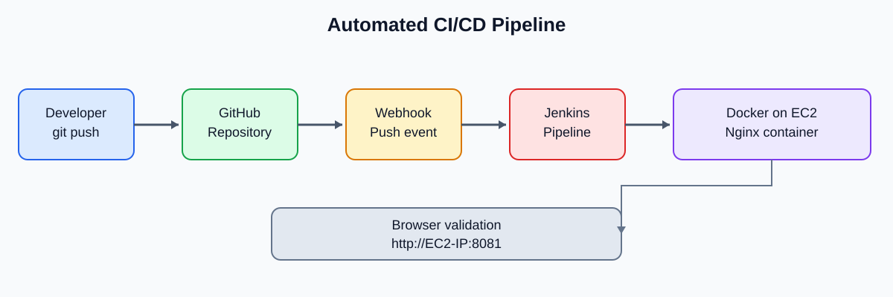

# Automated CI/CD Pipeline for a Dockerized Web Application

A beginner-friendly DevOps project using **GitHub, GitHub Webhooks, Jenkins, Docker, Nginx, and AWS EC2**.

> **Verified in the original lab:** a GitHub push triggered Jenkins, the pipeline finished with `SUCCESS`, and the updated website displayed `Automatic deployment test`. This repository package documents that workflow. Add your own real console screenshots under `screenshots/`; they are not fabricated here.

## Architecture



**Flow:** Developer → GitHub → webhook → Jenkins pipeline → Docker image → Nginx container on EC2 → browser.

## Repository layout

```text
.
├── README.md
├── Dockerfile
├── Jenkinsfile
├── index.html
├── .gitignore
├── docs/
│   ├── 01-project-overview.md
│   ├── 02-aws-setup.md
│   ├── 03-install-jenkins-docker.md
│   ├── 04-github-webhook.md
│   ├── 05-jenkins-pipeline.md
│   ├── 06-testing-results.md
│   ├── 07-troubleshooting.md
│   ├── 08-security-cleanup.md
│   ├── 09-interview-questions.md
│   └── images/cicd-architecture.svg
└── screenshots/
    └── README.md
```

## Technologies

- **AWS EC2 / Ubuntu:** hosts Jenkins and the application container in this learning lab.
- **GitHub:** stores source code and sends push events.
- **GitHub Webhook:** triggers Jenkins after a push.
- **Jenkins:** automates checkout, image build, and deployment.
- **Docker:** packages the website.
- **Nginx:** serves the HTML page.

## Run locally with Docker

Requirements: Docker installed and running.

```bash
git clone https://github.com/sibinkalex/docker-cicd-project.git
cd docker-cicd-project
docker build -t cicd-webapp:latest .
docker run -d --name cicd-test -p 8081:80 cicd-webapp:latest
```

Open `http://localhost:8081`.

To rebuild and redeploy after editing `index.html`:

```bash
docker build -t cicd-webapp:latest .
docker rm -f cicd-test 2>/dev/null || true
docker run -d --name cicd-test -p 8081:80 cicd-webapp:latest
```

Stop the container:

```bash
docker rm -f cicd-test
```

## Full guide — follow in order

1. [Project overview](docs/01-project-overview.md)
2. [AWS setup](docs/02-aws-setup.md)
3. [Install Jenkins and Docker](docs/03-install-jenkins-docker.md)
4. [GitHub and webhook](docs/04-github-webhook.md)
5. [Configure Jenkins pipeline](docs/05-jenkins-pipeline.md)
6. [Testing and results](docs/06-testing-results.md)
7. [Troubleshooting](docs/07-troubleshooting.md)
8. [Security and cleanup](docs/08-security-cleanup.md)
9. [Interview questions](docs/09-interview-questions.md)

## Screenshots

Save genuine screenshots from your environment in `screenshots/`. The exact suggested filenames are listed in [`screenshots/README.md`](screenshots/README.md). The SVG architecture is an illustrative diagram, not a live AWS/Jenkins screenshot.

## Resume description

**Automated CI/CD Pipeline for a Dockerized Web Application**  
*Technologies: AWS EC2, Ubuntu, Jenkins, Docker, GitHub, GitHub Webhooks, Nginx*

- Built a Docker image for a static Nginx web application.
- Created a Jenkins declarative pipeline to check out source code, build the image, and deploy the application container.
- Configured a GitHub webhook to trigger Jenkins after repository pushes.
- Tested a code change end-to-end and confirmed the updated page was served by the new container.
- Troubleshot a Jenkins memory-related failure by configuring swap space on the EC2 lab host.

## Security

This is a learning lab, not a production-ready architecture. Do not expose Jenkins or SSH to the entire internet. Restrict SSH to your IP, protect Jenkins with HTTPS and access controls, and clean up unused AWS resources. Never commit `.pem` files, AWS credentials, GitHub tokens, or passwords.
